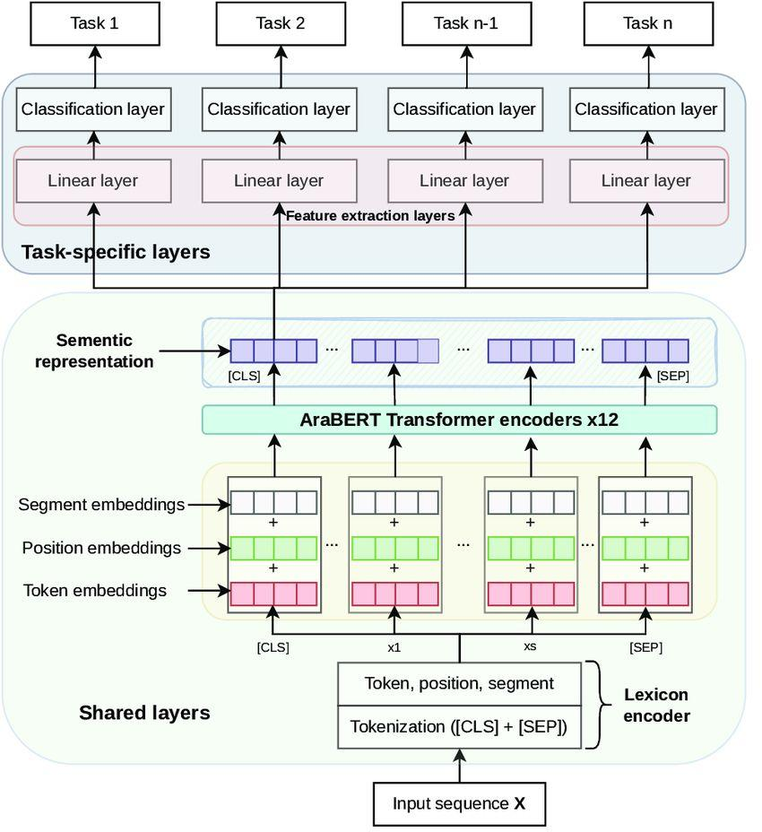
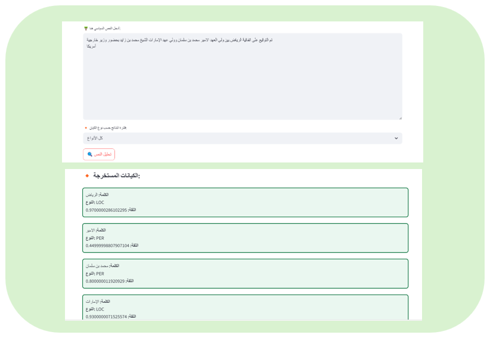

# Arabic Political NER with AraBERT
### استخراج الكيانات المسمّاة من النصوص السياسية العربية باستخدام AraBERT


> 👥 **Team project, led by Wasan Alomar** · Course: Natural Language Processing (NLP)
>
> 👥 **مشروع جماعي بقيادة وسن آل عمر** · المقرر: معالجة اللغات الطبيعية (NLP)

[English](#english) · [العربية](#arabic)


---

<a id="english"></a>
## 🇬🇧 English

### Overview
A Named Entity Recognition (NER) system for **Arabic political text**, built by fine-tuning the pre-trained **AraBERT** transformer. The system automatically extracts **persons, organizations, locations and miscellaneous entities** from political letters, speeches and diplomatic correspondence, to support faster and more accurate decision-making in governmental and diplomatic work.

**Use case:** an employee at a foreign ministry receives hundreds of diplomatic messages a day. The system reads each message, pulls out the key people, countries and organizations, and presents a clear summary so the next action can be taken without reading the full text.

### Highlights
- Fine-tuned `aubmindlab/bert-base-arabertv02` for token classification (BIO tagging)
- Sub-word label alignment for Arabic's rich morphology
- Full pipeline: data loading → cleaning → tokenization → training → evaluation → inference
- Arabic web interface that extracts entities with confidence scores and filters them by type

### Results

| Split | Accuracy | Precision | Recall | F1-Score | Loss |
|---|---|---|---|---|---|
| Validation | 95.44% | 87.18% | 84.10% | 85.43% | 0.2123 |
| Test | 94.35% | 82.29% | 82.56% | 82.41% | 0.2957 |

*Token-level metrics, macro-averaged across the 9 BIO classes.*

Best performance on **persons (PER)** and **organizations (ORG)**; **miscellaneous (MISC)** entities are the hardest due to fewer training examples.

**Example inference:**

| Entity | Type | 
|---|---|
| سلمان بن عبدالعزيز | PER |
| الشرق الأوسط | LOC |
| القاهرة | LOC |
| العربية | MISC |

### Dataset
[`iSemantics/conllpp-ner-ar`](https://huggingface.co/datasets/iSemantics/conllpp-ner-ar) from Hugging Face, Arabic text annotated in BIO format.

| Split | Examples |
|---|---|
| Train | 10,250 |
| Validation | 2,383 |
| Test | 2,572 |

Labels: `O`, `B-PER`, `I-PER`, `B-ORG`, `I-ORG`, `B-LOC`, `I-LOC`, `B-MISC`, `I-MISC`

### Model & Training


| Setting | Value |
|---|---|
| Base model | `aubmindlab/bert-base-arabertv02` (12 transformer layers) |
| Max sequence length | 128 |
| Batch size | 16 |
| Epochs | 5 |
| Weight decay | 0.01 |
| Optimizer | AdamW (Hugging Face `Trainer`) |

### Interface


The interface accepts Arabic political text, displays every extracted entity with its type and confidence score, and lets the user filter results by entity type.

### Project Structure
```
├── notebooks/
│   └── arabic_ner_arabert.ipynb   # full pipeline: data → training → evaluation → inference
├── docs/
│   └── project_report.pdf         # full project report
├── assets/                        # figures and interface screenshots
├── requirements.txt
└── README.md
```

### How to Run
```bash
git clone https://github.com/<your-username>/arabic-political-ner-arabert.git
cd arabic-political-ner-arabert
pip install -r requirements.txt
jupyter notebook notebooks/arabic_ner_arabert.ipynb
```
Or open the notebook directly in **Google Colab**. A GPU is recommended for training.

### Future Work
- Extend to news articles, social media and parliamentary records
- Add entity linking and relation extraction
- Classify the tone and intent of political messages
- Generate draft official responses with natural language generation

📄 Full details in the [project report](docs/project_report.pdf).

---

<a id="arabic"></a>
<div dir="rtl">

## 🇸🇦 العربية

### نظرة عامة
نظام للتعرّف على الكيانات المسمّاة (NER) في **النصوص السياسية العربية**، مبني بتدريب نموذج **AraBERT** المُدرَّب مسبقاً وتخصيصه لهذه المهمة. يستخرج النظام تلقائياً **الأشخاص والمنظمات والمواقع والكيانات الأخرى** من الخطابات والرسائل السياسية والمراسلات الدبلوماسية، بهدف تسريع اتخاذ القرار ورفع دقته في العمل الحكومي والدبلوماسي.

**سيناريو الاستخدام:** موظف في وزارة الخارجية يستقبل مئات الرسائل الدبلوماسية يومياً. يقرأ النظام كل رسالة ويستخرج أهم الأشخاص والدول والمنظمات، ويعرض ملخصاً واضحاً يساعده على اتخاذ الإجراء المناسب دون قراءة النص كاملاً.

### أبرز النقاط
- تدريب نموذج `aubmindlab/bert-base-arabertv02` على تصنيف الكلمات بصيغة BIO
- مواءمة التصنيفات مع تقسيم الكلمات إلى أجزاء (Sub-words) لتناسب طبيعة اللغة العربية
- مسار متكامل: تحميل البيانات ← التنظيف ← التقطيع ← التدريب ← التقييم ← الاستخدام
- واجهة ويب عربية تعرض الكيانات المستخرجة مع نسبة الثقة، وتتيح تصفيتها حسب النوع

### النتائج

| المجموعة | الدقة الكلية | الدقة (Precision) | الاستدعاء (Recall) | F1 | الخسارة |
|---|---|---|---|---|---|
| التحقق | 95.44% | 87.18% | 84.10% | 85.43% | 0.2123 |
| الاختبار | 94.35% | 82.29% | 82.56% | 82.41% | 0.2957 |

أفضل أداء كان في التعرّف على **الأشخاص (PER)** و**المنظمات (ORG)**، بينما كانت **الكيانات المتنوعة (MISC)** الأصعب بسبب قلة أمثلتها في بيانات التدريب.

### البيانات
مجموعة [`iSemantics/conllpp-ner-ar`](https://huggingface.co/datasets/iSemantics/conllpp-ner-ar) من Hugging Face: 10,250 مثال للتدريب، و2,383 للتحقق، و2,572 للاختبار.

### التقنيات المستخدمة
Python · PyTorch · Hugging Face Transformers · Datasets · scikit-learn · Google Colab

### طريقة التشغيل
ثبّت المكتبات من ملف `requirements.txt` ثم افتح الملف `notebooks/arabic_ner_arabert.ipynb` في Jupyter أو Google Colab (يُفضّل استخدام GPU للتدريب).

### التطوير المستقبلي
- توسيع النظام ليشمل الأخبار ووسائل التواصل والمحاضر البرلمانية
- ربط الكيانات واستخراج العلاقات بينها
- تحليل نبرة الخطاب السياسي ونيّته
- توليد مسودات ردود رسمية آلياً

📄 التفاصيل الكاملة في [تقرير المشروع](docs/project_report.pdf).

</div>
